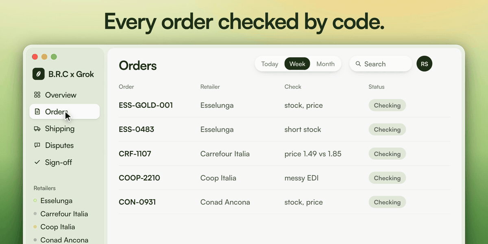
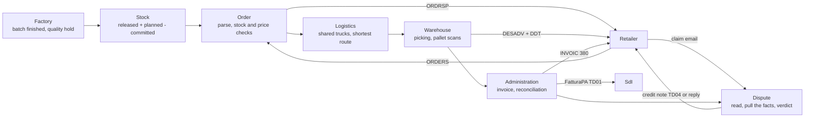

# B.R.C x Grok



A zero-touch back office on synthetic data + how data flows from the factory to the administration.

Grok agents run Riso Scotti's back office from the order to the cash. Code checks everything they do, and a person approves only what needs a human input.

## The problem

A rice order from Esselunga arrives as an EDIFACT file. Someone checks stock and contract price, the warehouse plans trucks and loads pallets, the office writes the delivery note, the invoice and the FatturaPA for SdI. Then maybe the retailer counts less than the invoice says and someone is forced to dig through four documents. IT'S A LOT OF STUFF TO MANAGE!

The only automatic check in Riso Scotti's CRM is an exact text match, "threeway". These are some problem we found when testing it:

- a one-letter typo in a reference turns into two false alarms
- a short delivery invoiced for what actually shipped comes out as matched, nobody chases the missing goods
- a price error behind a quantity problem is never named

We are in 2026... we can have better checks than a text matcher.

## Case study: an invisible error without Grok

Esselunga orders 12000 packs of Carnaroli 1 kg at €2.20 (CTR-SCOTTI-ESS-2026), and the next day six more orders leave the plant. Four things go wrong on the way. `python demo.py` runs the first three; the app (`pnpm db:reset`) runs the order, the shipping and the dispatch day.

| What goes wrong | Without our system | Money lost | With B.R.C x Grok |
|---|---|---|---|
| Order (PAL-ESS-GOLD-001-04) is scanned onto the wrong truck | No error is flagged and Esselunga claims the missing packs | **€2,112** credit note (960 × €2.20) | Code checks every scan against the plan and flags the error so that orders can be sorted correctly |
| 1,200 packs are held for quality, so only 10,800 ship | threeway says "matched" and nobody sends the missing packs | **€2,640** of ordered goods never delivered (1,200 × €2.20) | Code compares quantities line by line and flags the 1,200 packs still owed |
| Esselunga pays €300 less for a "promotional contribution" | It is booked as a normal short payment | **€300** | Code finds no credit note behind it and Grok no clause in the contract, so we ask Esselunga for the €300 back |
| Six orders ship on 6 Nov to five warehouses | Each order gets its own truck: 6 trucks, 1,591.7 km | **€426.89** of diesel more than needed | The Logistics agent puts orders on the same route on one truck: 2 trucks, 1,006.7 km |

That's **€5,478.89 at stake on one order and one dispatch day**. With us, code catches all four before they become a loss, and a person decides only where judgment is needed.

## Agents on every step

Grok does the work and code checks it. A person signs off at a few gates with one click and one line on why.

| Agent | What it does | What code checks | Who signs off |
|---|---|---|---|
| Order agent | Reads every ORDERS EDI. When a field is unclear (a date, a quantity) it proposes a fix, which is parsed again. Splits an order when stock is short | Stock from production events, contract price | The order desk confirms only unclear orders |
| Logistics agent | Groups orders for the same and nearby warehouses into shared trucks, finds the stop order, briefs the planner | 33 pallets and 24 t per truck, 9 h daily driving (EU 561/2006), real road km, every figure in Grok's briefing | The transport planner approves the plan before any truck is booked |
| Warehouse agent | Proposes the fix for a scan or truck exception: rescan, move a pallet, another truck | Every pallet scan against the plan, quality holds, batches | The warehouse lead approves |
| Documents and reconciliation | Code writes DESADV, DDT, FatturaPA TD01 and INVOIC, then reconciles order, delivery and invoice | Line by line, every cause named | A person only when the documents disagree |
| Dispute agent | Reads the claim email, pulls the documents, proposes a verdict with a source per point | Every amount tied to a document, the complaint window, duplicates | A person whenever anything is unclear |
| Cash agent | Matches each deduction to our credit notes; the rest become claims | Remittance against invoices and credit notes | A person decides each new claim |
| Forecast agent | Forecasts the stock we will need from past orders, so we know whether to buy, and the paddy price with Prophet, Meta's forecasting model | Each forecast against a simple guess: same week last year for demand, last price for the price | Nobody, it feeds the Purchasing agent |
| Purchasing agent | Buy-or-wait signals for paddy | Backtest against buying the same amount every week | The buyer decides every purchase |
| Learning | When a person closes an issue, the ticket is fed back to the agent, which learns from it | None overturned, and the person's reason still holds | A person approves each rule |

**Grok and the person.** Grok reads, fixes, plans, investigates and proposes, up to the truck and after it. Code rejects any figure Grok cannot tie to a record. The person's one line on why becomes an example Grok gets for the next similar case. In the golden run, 56 of our 63 logged steps are done by code and Grok and 7 by a person (`python demo.py`). In a replay of invented claims, the share of cases that need a person falls from 80% in week 1 to 16% by week 4 (`python -m agent.replay`).

## From the factory to the administration



Production enters only as events, so a batch on hold can never be promised or shipped. Every box writes to one Mini ERP (`core/erp.py`, one SQLite file) with the id of the document each record came from, so nothing is retyped and every action is traceable. Box by box: [docs/process-map.md](docs/process-map.md).

## Results against a baseline

| | Baseline | Ours | Source |
|---|---|---|---|
| Right call on whether someone must act | threeway 13/21 | 21/21 | `python -m bench.score`, [docs/results.md](docs/results.md) |
| Every cause named, nothing extra | threeway 10/21 | 21/21 | same |
| Km to deliver the 6 Nov orders | one truck per order: 1,591.7 | 1,006.7 (37% less) | OSRM road distances on OpenStreetMap |
| Diesel for the 6 Nov orders | €1,161.50 | €734.61 | 32.6 l/100 km (ICCT 2018), €2.238/l (MASE, week of 2 Nov 2026) |
| Trucks and driver days for the 6 Nov orders | 6 trucks, 7 days | 2 trucks, 3 days | same plan |
| Cases that need a person | 80% in week 1 | 16% by week 4 | `python -m agent.replay`, invented history |

We wrote the reconciliation cases ourselves to cover threeway's blind spots, so the jury's test set is the real test. The 6 Nov orders are invented; the roads, fuel use and diesel price are real and listed in `data/world/logistics.json`. How today's one-truck-per-order trips and the planned route are built, and the 7-order day now on the Shipping screen: [docs/routes.md](docs/routes.md).

## Open the dashboard

https://brc-x-grok.vercel.app

That link is the dashboard. It stays up when this Mac is off. There is no account and no install. The first open after a quiet stretch takes a few seconds while the demo database loads.

## Run it

The app the jury sees is in `agent-core/` (Next.js with the eve agent on Grok, one SQLite Mini ERP):

```bash
cd agent-core
pnpm install
cp .env.example .env.local    # set XAI_API_KEY=xai-... (every page also works without a key, on recorded answers)
pnpm db:reset                 # Mini ERP with the golden order and the 6 Nov dispatch day
pnpm test                     # the app's tests (147)
pnpm dev:web                  # starts the server and opens the B.R.C x Grok app. Then Shipping > "Send to the transport planner"
```

The Python rows are the reference the app is ported from:

```bash
./test.sh                     # every Python test (155), no key needed; the first run creates .venv with every package
source .venv/bin/activate     # then run the rest with the project's Python (system python3 lacks a38 and the rest)
python demo.py                # the golden order end to end, offline (--live calls Grok: XAI_API_KEY or GROK_API_KEY, or in a gitignored .env.local)
python -m scenarios.ambiguous_order   # an ambiguous order: Grok fixes the EDI, a person confirms, a crushed pallet, a €444 claim (--live, --me to decide yourself)
python -m bench.score         # us against threeway
python -m agent.replay        # the case curve (--svg docs/img/case-curve.svg)
python demo.py --db data/demo.sqlite                 # keeps the database for the next three
python -m core.trace data/demo.sqlite ESS-GOLD-001   # every document behind an order
python -m finance.receivables data/demo.sqlite       # aging and disputed deductions
python -m crm.api --db data/demo.sqlite              # JSON API for the CRM, chatbot at POST /api/ask
python scripts/build_logistics.py                    # rebuild data/world/logistics.json (needs the internet once)
```

Forecast and quality: `python -m forecast_quality.data`, then `.advisor`, `.quality`, `.demand`. Every folder is listed in [AGENTS.md](AGENTS.md).

## Known limitations

- All data is synthetic, nothing is sent to a retailer or to SdI.
