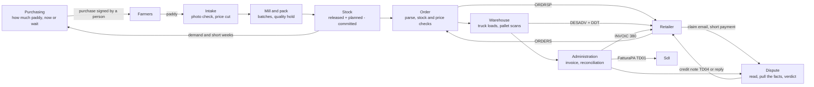

# B.R.C x Grok


An AI back office for Riso Scotti that cuts cost at every step from the paddy farmer to the retailer's payment. It decides how much paddy to buy and when, what a delivered lot is worth, what stock we can promise, how trucks are loaded, what gets invoiced and what a claim is really worth. Code does the routine work, Grok takes the exceptions, and a person decides only when a case is unclear.

The CRM desk is where people meet the system, and it is the biggest part of the build. The savings come from every step behind it.

## The problem

Every step between the farmer and the payment leaks money in small, ordinary ways:

- paddy bought at the wrong moment, or a lot paid at full price when its milling yield is under contract
- stock promised that is on quality hold or not made yet
- half-empty trucks, and pallets loaded onto the wrong one
- short deliveries nobody chases, because the invoice matches what shipped
- claims answered by digging through four documents, and deductions on a remittance that nobody questions

The only automatic check today is an exact text match. threeway, the track's baseline, joins order, delivery and invoice on order number plus item code, so a short delivery invoiced for what shipped comes out as matched, a one-letter typo in a reference turns into two false alarms, and a price error behind a quantity problem is never named.

## Case study: one order, with and without B.R.C

Esselunga orders 12,000 packs of Carnaroli 1 kg at the volume price of €2.20, so €26,400 net. On the way from the mill to the payment, six ordinary things go wrong. `python demo.py` replays the whole chain offline. Every figure below is printed by that run or comes from the product data in `data/world/products.json`.

| # | What goes wrong | Without B.R.C (people and threeway) | Cost without | With B.R.C |
|---|---|---|---|---|
| 1 | A 30 t Carnaroli paddy lot arrives with 20% broken grains | If the yield cut is missed at intake, the lot is paid at full price and can end up in premium packs | **€552** overpaid (30 t × €18.40/t) | The photo check gives a whole-grain yield of 56.0 against 58.0 in the contract. Code applies the contract cut of €18.40/t and sends the lot to rice drinks and cakes. The lot waits for the lab, which confirms it on a second sample |
| 2 | 1,200 packs go on quality hold (9% chalky grains), so only 10,800 ship | The invoice bills the 10,800 shipped, so threeway calls it **matched**. Nobody re-ships or warns Esselunga, and the shelf is short | **€2,640** of the order never delivered and never chased (fill rate 90%) | The held batch is never picked. Reconciliation flags `short_delivery`, and the weekly digest lists it under "short deliveries to follow up" |
| 3 | At the dock, one pallet is scanned onto the wrong truck | The pallet leaves on TRUCK-PV-02, off this delivery's DESADV and DDT. Esselunga counts one pallet missing and claims it, and we cannot prove where it went | **€2,112** (one pallet: 960 packs × €2.20) | The scan is tied to the truck's plate, so `WRONG_TRUCK` fires before departure. Grok proposes a rescan, Marco approves, and the truck leaves complete |
| 4 | A 240-pack pallet is missing at Esselunga's warehouse, noted on the signed DDT, and a claim email asks for €528 | Someone pulls the order, DESADV, invoice and signed DDT by hand and replies days later | €528 credit either way, plus the hours | The RECADV flags the €528 gap before the email arrives. Grok reads the claim and cites the DDT, the invoice and the Playbook. Nothing is unclear, so the TD04 credit note goes out with no person |
| 5 | Esselunga pays €23,882.40 of €24,710.40: €528 for our credit note, plus €300 with nothing behind it | The €300 looks like part of the same dispute and is written off | **€300** | The €528 is matched to our credit note automatically. The €300 becomes a claim, and Sara asks Esselunga to repay it. It stays tracked in receivables |
| 6 | Expected Carnaroli orders exceed stock in the coming weeks | The order desk keeps confirming against a stock figure that ignores expected demand, and the next orders ship short | the next short deliveries | The stock projection shows −6,414 packs in week 46 and tells the planner to make about 36,663 packs before then |

**€5,604 at stake around one €26,400 order** (rows 1, 2, 3 and 5), about a fifth of its value, plus the hours spent on row 4. With B.R.C, a person makes five decisions, and each one arrives with its evidence already gathered. On day one, half the cases close with no person (weekly digest). The learning loop below brings that share down over time. The case is synthetic: these figures show what each check is worth, not Riso Scotti's real losses.

## Efficiency at every step, from the paddy to the payment

| Step | Where money leaks | What B.R.C does | Status |
|---|---|---|---|
| **Buy paddy** | Paddy is most of the cost (about €100M a year). Buying too much, too little or at the wrong week moves the margin | "Paddy to buy": tonnes per variety from confirmed orders, the demand forecast, finished stock and silo stock, with a now-or-wait call from the price outlook. A person signs every purchase | Built (app, Inventory & Forecast). The timing shows no proven edge yet |
| **Paddy intake** | A lot under contract yield paid at full price, or broken rice packed as premium | A photo of the lab sample gives % broken and % chalky, the contract price cut and where the lot goes. A doubtful lot is held for a person | Built in Python (`demo.py`), measured by rules. Next: in the app, and a model trained on labelled grain images |
| **Production and stock** | Promising batches that are on hold or not made yet | Stock changes only through production events, and held batches never count. The projection flags the first short week and suggests a batch | Built |
| **Order** | Retyping EDI, or confirming what cannot ship | Code parses and checks stock and contract price. Grok fixes a messy order, and a person confirms before ORDRSP | Built |
| **Trucks** | Half-empty trucks, extra kilometres and diesel, pallets on the wrong truck | Orders for nearby warehouses on the same day share a truck, packed by pallet places and payload weight. Each truck gets the shortest route, with km, diesel € and CO2 against one truck per order. Scans tied to the plate catch a wrong pallet before departure | Built (app, Warehouse & Shipping): 6 orders on 4 trucks, 124 km of diesel saved on the demo day |
| **Invoice and match** | Short deliveries that look matched, typos raised as false alarms | The invoice is written from what shipped, and reconciliation names every cause | Built: 21/22 against threeway's 14/22 |
| **Claims and cash** | Hours per claim, and deductions written off | Claims answered with a source for every point. Deductions are matched to our credit notes, and any other deduction opens a claim | Built |

### How much paddy to buy, and when

Riso Scotti buys about 70% of its paddy from farmers (our figure, to confirm with the mentor). "Paddy to buy" in the app works out each variety over the next 8 weeks and shows every step with its source (`agent-core/agent/lib/purchasing/paddy.ts`):

1. **Rice we need** = confirmed orders not shipped + expected orders − finished rice released − production planned, in tonnes of milled rice. Expected orders come from the demand forecast: recent level × last year's seasonal shape × a promo uplift learned from past flyer weeks. On our invented two-year order history it beats "same week last year", 11.3% against 16.5% weighted error over the last 12 weeks.
2. **Paddy we need** = rice ÷ milling yield (70%, a demo value). Spread over 8 weeks, that gives the weekly use.
3. **Cover** = (paddy in the silos + paddy contracted but not delivered) ÷ weekly use.
4. **The call** comes from the price outlook 8 weeks ahead. If the price is expected to rise more than 2%, the call is BUY NOW, with a target of 16 weeks of cover. If it is expected to fall more than 2%, the call is WAIT, with 8 weeks. Otherwise it is BUY AS USUAL, with 12 weeks. If the price model does not beat "the price stays the same" in its own backtest, the call is BUY AS USUAL with low confidence, and that is the case today.
5. **Tonnes from farmers** = 70% × (target weeks × weekly use − paddy on hand). Spend = tonnes × the latest price.

Worked example (from the app's tests):

- 70 t of Carnaroli rice is confirmed and not shipped. That needs 100 t of paddy, or 12.5 t a week.
- There are 40 t in the silos and 20 t contracted, so 60 t on hand: 4.8 weeks of cover.
- The price is €672/t and expected to reach €700/t (+4.2%), so the call is BUY NOW with a 16-week target.
- The suggestion is 0.7 × (16 × 12.5 − 60) = **98 t from farmers, about €65,856**.

The proposal goes to Actions, where a person signs it. The app never buys.

The timing is measured against a baseline, honestly:

- The buy-or-wait backtest (`forecast_quality/advisor.py`) covers 64 variety-campaigns from 2017/18 to 2025/26 on real EU prices. It paid 0.38% less than buying the same amount every week, and did better in 32 of the 64 ([docs/forecast-results.md](docs/forecast-results.md)).
- The app's price model comes close to "the price stays the same" but does not beat it (Carnaroli: €51 error against €39).

So the proven value today is the amount, computed from real orders and stock. The timing is a signal for the buyer, not a saving. The stake is large: about 200,000 t a year at about €500/t, so every 1% is about €1M (our estimate).

### Quality: a photo of the sample, a person for the whole delivery

1. The lab already mills a 100 g sample of every paddy delivery. We photograph it on a black tray.
2. Code finds each grain and measures it. A grain is broken when it is shorter than 3/4 of a whole grain, and chalky when at least 3/4 of it is opaque white (the legal definition). Touching grains are left out, never counted as one big grain.
3. Broken grains lower the whole-grain yield. Within 1 point of the contract, the price does not change. Beyond that it drops by 10 kg × (milled price − broken price) per point, both prices from the EU data. At 6 points under, the lot can be refused (Pavia and Vercelli paddy contract templates).
4. The lot goes where it is worth most: premium 1 kg packs under 5% broken, standard packs under 15%, rice drinks and cakes above that.
5. A doubtful lot waits on the sign-off desk. That means more than 6% chalky, a price cut to apply, or too many clumps. The linked batch goes on hold, so nothing from it ships. A person in the lab then checks the delivery itself, not just the photographed sample, before it is paid or milled.

Today the measurement uses fixed rules on a synthetic tray. The next step is a classifier trained on GrainSet: 31K rice kernel images labelled by inspectors to ISO 5527. Its licence is non-commercial, so it needs the mentor's OK.

### Trucks: shared loads and shorter routes

The logistics agent (`agent-core/agent/lib/logistics/plan.ts`, on Warehouse & Shipping) plans the day:

- **Load.** Each order is measured in pallets and kg from the product data (Carnaroli 1 kg: 960 packs per pallet, 1 kg each). A missing weight or pallet size stops the plan, because nothing is guessed.
- **Share.** Orders are grouped by delivery date. Trucks are filled largest order first, by pallet places and then by weight (33 pallets and 24 t per truck). Delivery points within 40 km of each other share a truck when their windows overlap. An order is never split without a person.
- **Route.** Each truck gets the shortest loop from Pavia and back that the planner finds: nearest neighbour, then 2-opt.
- **Cost.** Diesel is km × 30 L/100 km, then × the diesel price. CO2 is 2.65 kg per litre.
- **Baseline.** One truck per order, each a straight round trip from Pavia.

On the demo day (six orders for five retailers, 6 and 9 November):

| | One truck per order | B.R.C plan |
|---|---|---|
| Trucks | 6 | **4** |
| Kilometres | 1,843 | **1,719** |
| Diesel | 553 L, €912 | **516 L, €851** |
| CO2 | 1,465 kg | **1,367 kg** |

The three Milan-area orders, for Rozzano, Milano and Melzo, ride one truck: 30 pallets, 23,080 kg, 129 km instead of 254. Bologna and Ancona keep their own trucks, because they are too far from the others to share. That also means two fewer trucks to hire and drive. The repo has no cost figure for that, so it is not counted.

These are estimates: straight-line distance × 1.3 on demo coordinates, and a demo diesel price of €1.65/L, close to the MIMIT weekly average.

The plan is a proposal. Real truck assignments go through the shipping row:

- **Exceptions.** An order that fits no truck becomes a case. Grok proposes another truck, code checks the proposal against the same capacity rules, and the transport planner approves.
- **Scans.** Every pallet is scanned onto the truck, tied to its plate. A wrong truck, a wrong batch, a held batch or a bad quantity keeps the pallet off until someone fixes it.

## How it works

- **Code** reads every EDI message, checks stock and contract price, plans the trucks, checks the pallet scans, and writes the delivery note, the invoice and the credit note. It also reconciles order, delivery and invoice line by line, and measures each paddy lot.
- **Grok** gets what code cannot settle: a messy order, short stock to split, a pallet on the wrong truck, a claim email to read, a verdict to propose. It answers in fixed JSON, and code checks the answer before anything happens. An amount Grok cannot tie to a document is dropped.
- **A person** signs off whenever a case is ambiguous: Grok is unsure, a point has no source, a document is missing, or the claim type is not in the Playbook. There is no euro threshold. A person also signs every paddy purchase and confirms every order before ORDRSP.
- **Improving loop.** Every decision is logged, and the closest past cases go into Grok's prompt. After the same decision three times with none overturned, code drafts a rule. Once a person approves it, the rule decides those cases with no Grok call. In a replay of invented claims, the share that needs a person falls from 78% in week 1 to 16% by week 4 (`python -m agent.replay`).

## From the paddy to the administration



Production enters only as events, so a batch on hold can never be promised or shipped. Every box writes to one Mini ERP (one SQLite file). Each record keeps the id of the document it came from, so nothing is retyped and every action is traceable. Box by box: [docs/process-map.md](docs/process-map.md).

## Result against the baseline

On 22 labelled cases ([docs/results.md](docs/results.md)):

| | threeway | ours |
|---|---|---|
| Right call on whether someone must act | 14/22 | 21/22 |
| Every cause named, nothing extra | 10/22 | 21/22 |

We wrote the cases ourselves to cover threeway's blind spots, so the jury's test set is the real test. Our one miss (C19) is a labelling slip, explained in the results.

## Run it

The app the jury sees is in `agent-core/`: Next.js with the eve agent, Grok as the chat, one SQLite Mini ERP and the HeyHandy UI. It has five sections:

- **Home:** Grok's chat and what the agents did this week.
- **Orders:** each order's journey.
- **Actions:** every case waiting for a person, from every row.
- **Inventory & Forecast:** stock and Paddy to buy.
- **Warehouse & Shipping:** trucks, routes and scans.

```bash
cd agent-core && nvm use && pnpm install
pnpm setup:py                 # Python env for the paddy price forecaster
cp .env.example .env.local    # set XAI_API_KEY=xai-... (every page works without it; only the chat needs it)
pnpm db:reset                 # Mini ERP with the golden order run through every row
pnpm dev:web                  # http://localhost:3000
```

The Python rows are the reference the app is ported from:

```bash
./test.sh                     # every Python test, no key needed; the first run creates .venv
source .venv/bin/activate     # then run the rest with the project's Python
python demo.py                # the case study above, offline (--live calls Grok: XAI_API_KEY or GROK_API_KEY)
python -m scenarios.ambiguous_order   # Grok fixes a messy EDI, a person confirms, a crushed pallet, a €444 claim
python -m bench.score         # us against threeway
python -m agent.replay        # the case curve (--svg docs/img/case-curve.svg)
python -m forecast_quality.advisor    # buy-or-wait backtest and this week's calls (after python -m forecast_quality.data)
python -m forecast_quality.quality data/quality/sample_tray.png --variety Carnaroli --lot LOT-PADDY-17
python demo.py --db data/demo.sqlite                 # keeps the database for the next three
python -m core.trace data/demo.sqlite ESS-GOLD-001   # every document behind an order
python -m finance.receivables data/demo.sqlite       # aging and disputed deductions
python -m crm.api --db data/demo.sqlite              # JSON API for the CRM, chatbot at POST /api/ask
```

Every folder is listed in [AGENTS.md](AGENTS.md).

## Known limitations

- Orders, stock, trucks, claims and the order history are synthetic. Nothing is sent to a retailer or to SdI. The paddy prices are real public data (EU Agri-food portal, World Bank, ECB).
- The timing of paddy purchases shows no proven saving yet. Buy-or-wait was 0.38% better than even buying, and better in 32 of 64 campaigns. The app's price model does not beat "the price stays the same". The prices are farm-gate averages, not what Riso Scotti pays.
- These are our estimates and demo values, to confirm with the mentor: the 70% bought from farmers, the 70% milling yield, the 200,000 t a year, silo stock, and the contract yields per variety.
- The quality check runs in Python and `demo.py`, not in the app yet. It measures grains with fixed rules on a synthetic tray photo, has no trained model, and has not seen a real lab photo yet.
- Truck routes use straight-line distance × 1.3 on demo coordinates, with a demo fuel use and diesel price. The plan is a proposal: real assignments still go through the shipping row's first-fit planner.
- `shipping/` is rebuilt from Nicola's v0.5.0 write-up; his code replaces ours when it arrives.
- Grok's live calls are tested with recorded answers only. The Python default model is `grok-4-latest` (set `XAI_MODEL` or `GROK_MODEL` to override). The app uses `grok-4.7`.

Team, how we work and what we deliver: [docs/team.md](docs/team.md).
