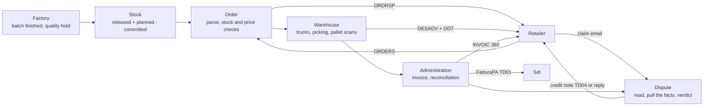
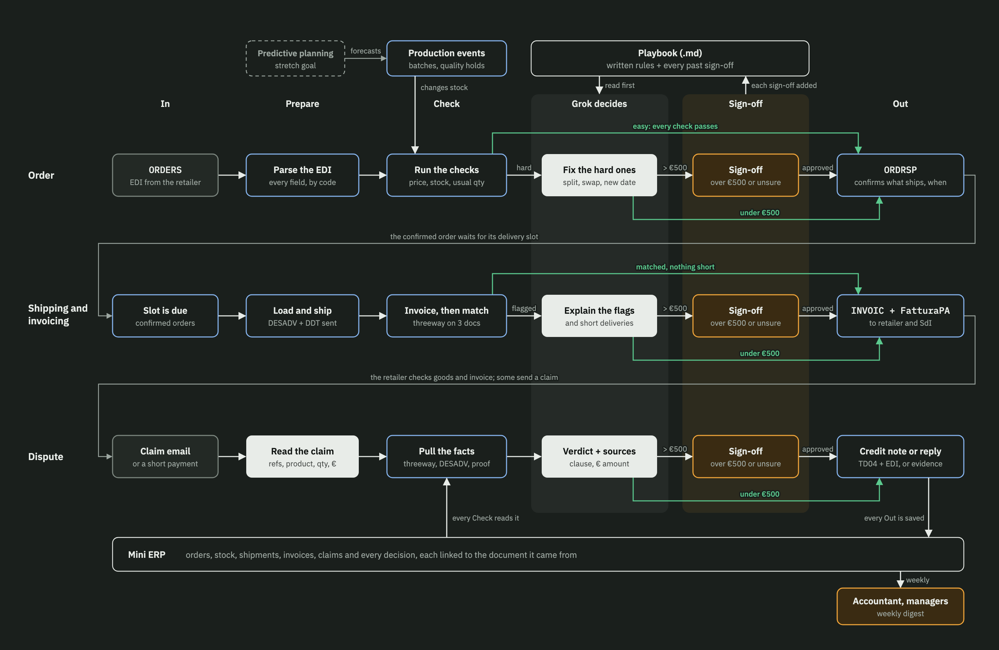

# B.R.C x Grok


Grok Hackathon Pavia 2026, Track B, for Riso Scotti. The brief: a "zero-touch" back office on synthetic data, plus an architectural concept of how data flows from the factory to the administration.

## The problem

A rice order from Esselunga arrives as an EDIFACT file. Before Riso Scotti can say yes, someone checks the stock and the contract price. The warehouse plans the trucks, picks the pallets and loads them. The office writes the delivery note, the invoice and the FatturaPA for SdI. Then the retailer counts less than the invoice says, or pays less, and sends a claim email that someone answers by digging through four documents.

In a back office run by hand, each of those hand-offs is a person moving numbers from one document to the next. The automatic check that is supposed to catch mistakes is an exact text match. threeway, the baseline the track gives us, joins the order, the delivery and the invoice on order number plus item code. Reading its code, we found that:

- a short delivery invoiced for what actually shipped comes out as "matched", so nobody chases the missing goods
- a one-letter typo in a reference turns into two false alarms
- a price error behind a quantity problem is never named

## What we built

One back office where code does the work, Grok takes the exceptions, and a person steps in only when a case is unclear.

- **Code** reads every EDI message, checks stock and contract prices, plans the trucks, checks the pallet scans, writes the delivery note, the invoice and the credit note, and reconciles order, delivery and invoice line by line.
- **Grok** gets what code cannot settle: a messy order, short stock to split, a claim email to read, a verdict to propose. It answers in fixed JSON and code checks the answer before anything happens. An amount Grok cannot tie to a document is dropped.
- **A person** signs off whenever a case is ambiguous: Grok is unsure, a point has no source, a document is missing, the claim type is not in the Playbook. There is no euro threshold. A clear case goes out whatever the amount, and an unclear one waits for a person whatever the amount.
- **Every record** keeps the id of the document it came from, and every action is written to an audit log.

## One order, end to end

`python demo.py` runs the golden order through every row, offline, with recorded Grok answers:

1. Esselunga orders 12,000 packs of Carnaroli. Stock and price check out, Giulia confirms, and the ORDRSP goes back.
2. The factory puts 1,200 packs of one batch on quality hold, so only 10,800 can ship.
3. Twelve pallets are picked from released batches. One is scanned onto the wrong truck: Grok proposes a rescan, Marco approves, the truck leaves.
4. Invoice FT-2026/0001 bills the 10,800 shipped, €23,760.00 net plus 4% VAT, as a FatturaPA TD01 checked with python-a38. Our reconciliation names the short delivery. threeway would call this line matched.
5. Esselunga writes that a pallet of 240 packs is missing and asks for €528. Grok reads the email, code pulls the order, the delivery, the invoice and the signed proof of delivery, and Grok proposes to accept, citing three sources. Nothing is unclear, so the credit note goes out with no person.
6. A second claim is unclear. It waits in the sign-off queue until Sara approves a reply with the evidence.

The run ends with 45 events in the audit log and a weekly digest.

## From the factory to the administration



Production enters only as events, so stock always says where it came from, and a batch on hold can never be promised or shipped. Every box above writes to one Mini ERP (`core/erp.py`, a single SQLite file), so Order hands Shipping a confirmed order and Shipping hands Dispute the documents with nothing retyped. Grok and the sign-off queue sit beside every row: code calls Grok on an exception, and an unclear case goes to one queue for all rows (`core/signoff.py`).

## Result against the baseline

On 22 labelled cases (`data/bench/cases.json`, full table in [docs/results.md](docs/results.md)):

| | threeway | ours |
|---|---|---|
| Right call on whether someone must act | 14/22 | 21/22 |
| Every cause named, nothing extra | 10/22 | 21/22 |

The gains come from the blind spots we found in threeway's code: a short delivery invoiced correctly ("matched" for threeway), a second cause on the same line, a one-character typo in a reference, item codes written without dashes, and cartons invoiced as packs. We wrote the cases and their answers ourselves, so this shows those blind spots are handled; the jury's test set is the real test. Our one miss, C19, is a labelling slip on our side, explained in [docs/results.md](docs/results.md).

## Run it

```bash
./test.sh                  # the whole test suite (creates .venv, installs requirements, runs pytest)
python demo.py             # the golden order through every row, offline with recorded Grok answers
python demo.py --live      # the same, calling Grok (needs XAI_API_KEY or GROK_API_KEY)
python -m bench.score      # our reconciliation against the threeway baseline
python -m core.digest data/demo.sqlite   # weekly digest, after: python demo.py --db data/demo.sqlite
```

Nothing needs a key or the network except `--live`. Without a key, every Grok step falls back to what code can do on its own, or stops at a person.

## The process map



- **Columns** are the kind of work, the same in every row: In, Prepare, Check, Grok decides, Sign-off, Out.
- **Rows** are moments in an order's life: the order arrives, it is shipped and invoiced, and sometimes it comes back as a dispute.
- **Colours** show who does the work: grey is the retailer, blue outline is code, white is Grok, amber is a person, dashed is a stretch goal.
- **Green lines** are the zero-touch paths: clean cases skip Grok, and Grok decisions with nothing ambiguous skip the person.

The full walkthrough, box by box, is in [docs/process-map.md](docs/process-map.md). The interactive version of the map is [here](https://claude.ai/artifact/T91ncru9B4aTf8kup8AvE7).

## Where the code is

| Folder | What it does |
|---|---|
| `core/` | Mini ERP (one SQLite file for every row, every record linked to its document, an audit log of every action), stock and production events, the sign-off queue for all rows, the weekly digest |
| `agent/` | The one Grok client every row uses: JSON answers, one retry with the checks' reasons, a model per task |
| `order/` | ORDERS parser, stock and contract price checks, Grokbot (EDI fix, short stock, price mail), ORDRSP and the hand-over (`order/service.py`) |
| `shipping/` | Hand-over in, trucks, picking, pallet scans, dispatch, DESADV and DDT, invoice (FatturaPA TD01 + INVOIC 380), reconciliation, exception cases, hand-over to Dispute |
| `dispute/` | Claim reader, pull the facts, verdict with sources, credit note (TD04 + INVOIC 381) or evidence reply (`dispute/service.py` runs it on the Mini ERP) |
| `bench/` | The comparison with threeway |
| `data/world/` | The one fake world: products (GTIN and item code), retailers, starting stock, the golden order and its claim |
| `demo.py` | The golden order end to end |

## Known limitations

- All data is synthetic, and every document is a demo document: nothing is sent to a retailer or to SdI.
- `shipping/` is rebuilt from Nicola's v0.5.0 write-up because his code is not in this repo. When it arrives, his version of a function replaces ours.
- Grok's live calls are tested with recorded answers only. The default model is `grok-4-latest` (`grok-2-latest` answers 404); set `XAI_MODEL` or `GROK_MODEL` to override.
- The sign-off queue has no screen yet: the CRM will list `core.signoff.pending()` and call `decide()`. The dashboard in the banner shows where it is going.
- Forecast and quality (buy-or-wait, lot photo check) is a plan in DECISIONS.md, with no code yet.

## Team

| Area | Boxes on the map | File |
|---|---|---|
| Order | ORDERS, Parse the EDI, Run the checks, Fix the hard ones, ORDRSP | [docs/order.md](docs/order.md) |
| Shipping and invoicing | Slot is due, Load and ship, Invoice then match, Explain the flags, INVOIC + FatturaPA | [docs/shipping.md](docs/shipping.md) |
| Dispute | Claim email, Read the claim, Pull the facts, Verdict + sources, Credit note or reply | [docs/dispute.md](docs/dispute.md) |
| Shared core | Mini ERP, Playbook, Sign-off, Production events, synthetic data, golden order | [docs/core.md](docs/core.md) |

### How we share what we find

- Each owner keeps their findings file up to date, using the sections already in it. Short facts with a source link, not pasted articles.
- Anything that changes what another area receives goes in [DECISIONS.md](DECISIONS.md) first, one line, with who and when.
- Questions for the Riso Scotti mentor go in [MENTOR.md](MENTOR.md), so we ask them once, together, and write the answers there.
- Everyone uses the same fake world in `data/`, and the same golden order that goes through every row.
- Sync every 3 hours, 10 minutes: what changed in what you receive or hand over, what blocks you, one finding the others need.
- WhatsApp is for pings. If it matters to someone else, it goes in the repo.
- Coding agents (Claude Code, Codex, Cursor) read `AGENTS.md`: at the root for orientation, plus `agent-core/AGENTS.md` (Rice Agent, eve, web UI) and `planning/AGENTS.md` (Python forecaster). Update them when you change how something works.

### What we have to deliver

From the brief: this repo with a README, the data we used, at least one result measured against the baseline (threeway), and the known limitations. The minimum demo runs on Thursday by 16:00, on a new case chosen by the jury:

- one new order handled end to end, from receipt to reconciliation
- a proposed resolution, with evidence, for at least one dispute
- human sign-off for any decision above a set threshold. Ours is set on ambiguity, not on euros (see [What we built](#what-we-built)).
