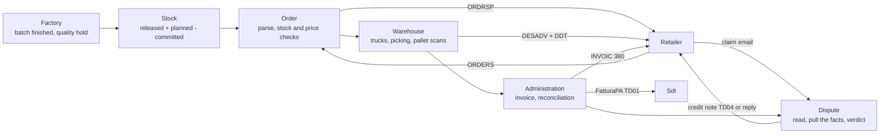

# B.R.C x Grok


A zero-touch back office on synthetic data + an architectural concept of how data flows from the factory to the administration.

## The problem

A rice order from Esselunga arrives as an EDIFACT file. Someone checks stock and contract price, the warehouse plans trucks and loads pallets, the office writes the delivery note, the invoice and the FatturaPA for SdI. Then the retailer counts less than the invoice says, or pays less, and someone answers the claim by digging through four documents. IT'S A LOT OF STUFF TO MANAGE!

The only automatic check is an exact text match. threeway, the track's baseline, joins order, delivery and invoice on order number plus item code, so:

- a short delivery invoiced for what actually shipped comes out as "matched", and nobody chases the missing goods
- a one-letter typo in a reference turns into two false alarms
- a price error behind a quantity problem is never named

We are in 2026... we can have better checks than a text matcher.

## What we built

Code does the work, Grok takes the exceptions, and a person is called only when a case is unclear.

- **Code** reads every EDI message, checks stock against the forecast, plans the trucks, checks the pallet scans, writes the delivery note, the invoice and the credit note, and reconciles order, delivery and invoice line by line.
- **Grok** gets what code cannot settle: a messy order, short stock to split, a claim email to read, a verdict to propose. It answers in fixed JSON and code checks it before anything happens; an amount Grok cannot tie to a document is dropped.
- **A person** signs off whenever a case is ambiguous: Grok is unsure, a point has no source, a document is missing, the claim type is not in the Playbook. No euro threshold.
- **Improving loop:** every decision is logged, and the closest past cases go into Grok's prompt. After the same decision three times with none overturned, code drafts a rule; once a person approves it, the rule decides those cases with no Grok call. In a replay of invented claims, the share that needs a person falls from 80% in week 1 to 16% by week 4 (`python -m agent.replay`).

## Case study: an invisible error without Grok

`python demo.py` runs the golden order through every row, offline:

1. Esselunga orders 12,000 packs of Carnaroli. Stock and price check out, Giulia confirms, the ORDRSP goes back.
2. The factory puts 1,200 packs on quality hold, so only 10,800 ship. One pallet is scanned onto the wrong truck; Grok proposes a rescan and Marco approves.
3. Invoice FT-2026/0001 bills the 10,800 shipped (€23,760 net, FatturaPA TD01). We flag the short delivery; **threeway calls it matched**.
4. Esselunga claims a missing pallet of 240 packs, €528. Code pulls order, delivery, invoice and signed proof of delivery; Grok proposes to accept, citing three sources. Nothing is unclear, so the credit note goes out with no person.
5. A second, unclear claim waits in the sign-off queue until Sara approves the reply.
6. Esselunga pays: the €528 deduction matches our credit note, and a €300 deduction with nothing behind it goes to a person. 63 audit events and a weekly digest close the run.

## From the factory to the administration



Production enters only as events, so a batch on hold can never be promised or shipped. Every box writes to one Mini ERP (`core/erp.py`, one SQLite file) with the id of the document each record came from, so nothing is retyped and every action is traceable. Box by box: [docs/process-map.md](docs/process-map.md).

## Result against the baseline

On 22 labelled cases ([docs/results.md](docs/results.md)):

| | threeway | ours |
|---|---|---|
| Right call on whether someone must act | 14/22 | 21/22 |
| Every cause named, nothing extra | 10/22 | 21/22 |

We wrote the cases ourselves to cover threeway's blind spots, so the jury's test set is the real test. Our one miss (C19) is a labelling slip, explained in the results.

## Run it

```bash
./test.sh                     # every test (142), no key needed
python demo.py                # the golden order end to end, offline (--live calls Grok: XAI_API_KEY or GROK_API_KEY)
python -m bench.score         # us against threeway
python -m agent.replay        # the case curve (--svg docs/img/case-curve.svg)
python demo.py --db data/demo.sqlite                 # keeps the database for the next three
python -m core.trace data/demo.sqlite ESS-GOLD-001   # every document behind an order
python -m finance.receivables data/demo.sqlite       # aging and disputed deductions
python -m crm.api --db data/demo.sqlite              # JSON API for the CRM, chatbot at POST /api/ask
```

Forecast and quality: `python -m forecast_quality.data`, then `.advisor`, `.quality`, `.demand`. The Rice Agent (paddy price outlook with Grok, web UI) is in `agent-core/`. Every folder is listed in [AGENTS.md](AGENTS.md).

## Known limitations

- All data is synthetic; nothing is sent to a retailer or to SdI. The case curve and the demand forecast run on invented history.
- `shipping/` is rebuilt from Nicola's v0.5.0 write-up; his code replaces ours when it arrives.
- Grok's live calls are tested with recorded answers only. Default model `grok-4-latest`; set `XAI_MODEL` or `GROK_MODEL` to override.
- The CRM has its backend and API but no screen yet.
- Buy-or-wait shows no proven saving yet (+0.38% against even buying, better in 32 of 64 campaigns), so we pitch it as signals, not savings ([docs/forecast-results.md](docs/forecast-results.md)).

Team, how we work and what we deliver: [docs/team.md](docs/team.md).
