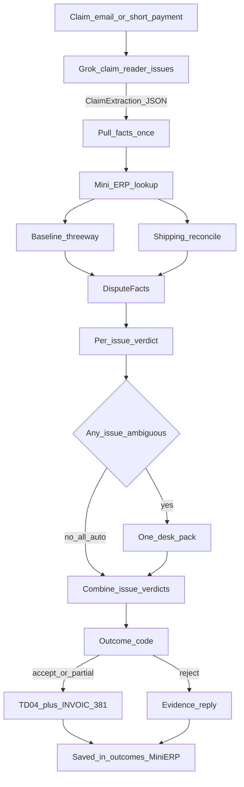

# Dispute decisions (subdocument of [DECISIONS.md](DECISIONS.md))

Design / procedere della riga **Dispute**, allineato a [dispute/README.md](dispute/README.md), [docs/dispute.md](docs/dispute.md) e al codice in `dispute/`.

Parent index: [DECISIONS.md](DECISIONS.md). Stile schemino: come [order-dec.md](order-dec.md).

## Scope

Solo la riga **Dispute**: Claim email → Read the claim → Pull the facts → Verdict + sources → (sign-off se serve) → Credit note **oppure** evidence reply.

**Pipeline: done.** Fuori scope ancora: Sign-off **web** UI condivisa (c’è il desk CLI `python -m dispute.desk`); nuova fattura di ricarico (vietata). La mappa HTML “>€500” è **obsoleta** — nessuna soglia in euro (4 Nov).

## Pipeline (come Order)

## Step by step

### 1. In — Claim email

- Arriva una mail/contestazione retailer (o testo di short payment).
- Tipi demo: shortage, pricing/promo, damage, short payment, late/OTIF, ambiguous.
- Fixture: `data/disputes/claims/`.

### 2. Read the claim — `claim_reader.py` (Grok)

- Estrae JSON strutturato: `order_ref`, `invoice_ref`, `confidence`, `raw_notes`, e **`issues[]`** (`claim_type`, `product`, `quantity`, `amount`, `notes` per problema).
- Forma legacy (un solo `claim_type` / qty / amount in cima) → sintetizzata in `issues` con un elemento; i campi top-level restano lo specchio di `issues[0]`.
- **Non inventa** ref mancanti → `null`. Un’ambiguità sullo stesso fatto (shortage vs OTIF) resta **un** issue `other`, non duplicati.
- Live: `XAI_API_KEY` / `GROK_API_KEY`. Dry-run / extraction JSON a mano per test senza API.
- Output salvabile sotto `data/disputes/extractions/`.

### 3. Pull the facts — `pull_facts.py` + `mini_erp.py` (codice)

- Risolve ordine / DESADV / invoice / proofs dal Mini ERP esportato da Shipping e/o dal catalog mock (`data/disputes/erp/catalog.json`) — **una volta per claim**, non per issue.
- Esegue **baseline threeway** (vendored `dispute/_threeway_core.py`) **e** `shipping.reconcile.reconcile_documents` (stesso codice del bench).
- Produce `DisputeFacts`: claim + docs + `threeway` + `reconcile` (status, causes, explanation) + `misses`.
- Path jury: `handle_claim(..., include_fixtures=False)` / `python -m dispute.service --db …` / `run_dispute_claim.sh --erp-db …`.

### 4. Verdict + sources — `verdict.py` (Grok), una volta per issue

- Per ogni issue: Playbook + contract + claim scoped + facts → `accept` | `partial` | `reject` con `points[]` e **source**.
- Importi solo da claim / docs / threeway / reconcile eur — codice clampa/droppa euro inventati.
- `needs_sign_off` per issue: **nessuna soglia in euro**. True se qualcosa è ambiguo (stesse regole di prima).
- `handle_claim` combina i verdict in un parent: punti concatenati, importo = somma dei credit, decisione `accept` / `reject` / `partial` a seconda degli issue.

### 5. Sign-off (condizionale) + learning

- Issue chiari si auto-chiudono nel pass; i leftover ambigui condividono **un** caso desk (`pending_issues` + `auto_issues` nella proposal). Niente TD04/reply finché il pack non è chiuso (anche se alcuni issue erano chiari).
- **`approve_verdict`** approva tutto il pack pending, ricombina, emette l’outcome, e **`activate_from_person` una volta per issue type** (così i claim single-type futuri imparano).
- Desk CLI: `python -m dispute.desk --db data/demo.sqlite list|show|approve|reject`.
- Port TypeScript `agent-core`: dopo, non in questo cambiamento.

### 6. Out — `outcome.py` (codice)

- **accept / partial** → FatturaPA **TD04** (`a38`) + EDI INVOIC hint `BGM+381` (un documento per claim, importo combinato).
- **reject** → reply con evidenze (incluso `reconcile` causes).
- Mai una nuova invoice di addebito.
- Output: `data/disputes/outcomes/` + Mini ERP documents.

## Lavoro corrente (dopo la pipeline)

1. Citare Shipping reconcile nei verdict live (i facts già lo espongono).
2. Desk CLI come superficie persona fino al CRM condiviso.
3. Path `--erp-db` senza fixtures per claim scelti dalla giuria.

## Regole fissate

- Grok decide e spiega; **il codice scrive** i documenti e gli importi finali.
- Ogni punto del verdict ha una **source** tracciabile.
- Threeway baseline + Shipping reconcile girano dentro Dispute.
- Fine disputa = TD04/credit **o** evidence reply.

## Cosa Dispute chiede / dà agli altri

| Direzione | Cosa |
|---|---|
| Da Core / Shipping | Order, DESADV, invoice, DDT/POD, stock events nel Mini ERP |
| Da Forecast/quality | record qualità lotto come prova “contested goods” (non ancora cablato) |
| A Core / retailer | verdict + credit note o reply salvati |
| Interno Order | nessun handoff diretto; Dispute parte dal claim post-fattura |

## Non in questo documento

- UI web di sign-off (CRM).
- Handoff qualità lotto / Forecast.
