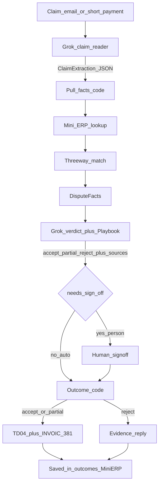

# Dispute decisions (subdocument of [DECISIONS.md](DECISIONS.md))

Design / procedere della riga **Dispute**, allineato a [dispute/README.md](dispute/README.md), [docs/dispute.md](docs/dispute.md) e al codice in `dispute/`.

Parent index: [DECISIONS.md](DECISIONS.md). Stile schemino: come [order-dec.md](order-dec.md).

## Scope

Solo la riga **Dispute**: Claim email → Read the claim → Pull the facts → Verdict + sources → (sign-off se serve) → Credit note **oppure** evidence reply.

Fuori scope (per Dispute oggi): Sign-off web UI dedicata; Mini ERP SQLite condiviso (usano catalog fixture); nuova fattura di ricarico (vietata).

## Pipeline (come Order)

## Step by step

### 1. In — Claim email

- Arriva una mail/contestazione retailer (o testo di short payment).
- Tipi demo: shortage, pricing/promo, damage, short payment, late/OTIF, ambiguous.
- Fixture: `data/disputes/claims/`.

### 2. Read the claim — `claim_reader.py` (Grok)

- Estrae JSON strutturato: `order_ref`, `invoice_ref`, `product`, `quantity`, `amount`, `claim_type`, `confidence`, `raw_notes`.
- **Non inventa** ref mancanti → `null`.
- Live: `XAI_API_KEY` / `GROK_API_KEY`. Dry-run / extraction JSON a mano per test senza API.
- Output salvabile sotto `data/disputes/extractions/`.

### 3. Pull the facts — `pull_facts.py` + `mini_erp.py` (codice)

- Risolve ordine / DESADV / invoice / proofs dal catalog mock (`data/disputes/erp/catalog.json`), anche con alias “loose”.
- Esegue **threeway** (vendored `dispute/_threeway_core.py`): join order+item, tollera micro-diff qty/€, una reason per riga flaggata; DESADV = merce ricevuta lato match.
- Produce `DisputeFacts`: claim + docs + threeway + `misses` (lookup falliti).
- Nessun Grok obbligatorio se parti da extraction JSON.

### 4. Verdict + sources — `verdict.py` (Grok)

- Legge **Playbook** (`data/disputes/playbook.md`) + **contract excerpt** + claim + facts.
- Decide `accept` | `partial` | `reject` con `points[]` ciascuno con **source** (order, desadv, invoice, ddt/pod, threeway, contract, playbook, …).
- Importi solo da claim / docs / threeway — codice clampa/droppa euro inventati.
- `needs_sign_off`: true se amount **>€500** (placeholder Playbook), unsure, source mancante, o tipo fuori Playbook.

### 5. Sign-off (condizionale)

- Se `needs_sign_off` → persona approva/modifica; caso approvato può entrare nel Playbook “past cases”.
- Se no → path auto verso outcome.
- UI web di sign-off: **out of scope** nel codice attuale (soglia solo da Playbook).

### 6. Out — `outcome.py` (codice)

- **accept / partial** → FatturaPA **TD04** (`a38`) + EDI INVOIC hint `BGM+381`. Importi/ref solo da verdict/facts.
- **reject** → reply con evidenze (DESADV, DDT, threeway, contract, …) citate dal verdict.
- Mai una nuova invoice di addebito: credit note **oppure** reply.
- Output: `data/disputes/outcomes/`.

## Regole fissate (dal codice / Playbook Dispute)

- Grok decide e spiega; **il codice scrive** i documenti e gli importi finali.
- Ogni punto del verdict ha una **source** tracciabile.
- Threeway gira dentro Dispute (e nel flusso shipping prima della fattura, altra riga).
- Fine disputa = TD04/credit **o** evidence reply.

## Cosa Dispute chiede / dà agli altri

| Direzione | Cosa |
|---|---|
| Da Core / Shipping | Order, DESADV, invoice, DDT/POD, stock events nel Mini ERP |
| Da Forecast/quality | record qualità lotto come prova “contested goods” |
| A Core / retailer | verdict + credit note o reply salvati |
| Interno Order | nessun handoff diretto; Dispute parte dal claim post-fattura |

## Non in questo documento

- Implementare la UI di sign-off.
- Unificare il catalog Dispute col Mini ERP condiviso di Core (oggi fixture locali).
