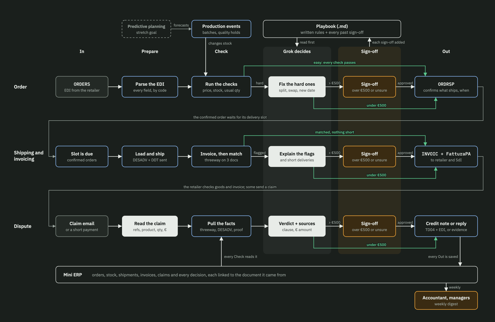

# The process map, box by box

## How to read it

**Columns are the kind of work**, the same in every row:

| Column | What happens there |
|---|---|
| In | Something arrives: an order, a delivery date, a complaint |
| Prepare | It is turned into clean data |
| Check | Code compares it with the facts: stock, prices, other documents |
| Grok decides | Grok steps in, only if a check failed |
| Sign-off | A person approves, only if more than €500 is at stake or Grok is unsure |
| Out | A document goes out |

**Rows are moments in an order's life**: the order arrives, it is shipped and invoiced, and sometimes it comes back as a dispute. The grey lines that wrap from the end of one row to the start of the next show time passing.

**Colours show who does the work**: grey is the retailer, blue outline is code, white is Grok, amber is a person, dashed is a stretch goal.

**White arrows** are the path when something needs attention. **Green lines** are the shortcuts where nobody intervenes:

- the green line on top: every check passed, so the case skips Grok and the person
- the green line underneath: Grok handled it and less than €500 is at stake, so it skips the person

## Row 1: Order

1. **ORDERS.** The retailer sends an order as an EDI message: which store, which products (barcodes), how many, at what price, for when.
2. **Parse the EDI.** Code reads it. The format is fixed, so no AI is needed.
3. **Run the checks.** Code asks: do we know these products and stores? Is the price the contract price? Do we have the stock, counting production coming up? Is the quantity normal for this store? If everything passes, the order is easy and takes the green line to the end. If anything fails, it is hard.
4. **Fix the hard ones.** Grok proposes a solution: ship 150 now and 50 next week, offer another pack size, move the date.
5. **Sign-off.** A person looks only if more than €500 is at stake or Grok is unsure.
6. **ORDRSP.** Code tells the retailer what will be delivered and when, before anything ships. A shortage agreed in advance does not become a complaint later.

## Row 2: Shipping and invoicing

1. **Slot is due.** The order waits for its delivery slot at the retailer's warehouse.
2. **Load and ship.** Code groups orders going to the same warehouse on the same day onto a truck. When it leaves, code sends the DESADV (the electronic list of what is on each pallet) and prints the DDT (the Italian transport document).
3. **Invoice, then match.** Code writes the invoice from what was actually shipped, then runs threeway to compare order, DESADV and invoice. If they agree, the invoice goes straight out on the green line.
4. **Explain the flags.** If threeway finds a gap, Grok explains it properly, for example "€36 gap = €22.50 for 10 units never delivered + €13.50 for a wrong price". It also checks short deliveries that threeway wrongly calls matched.
5. **Sign-off.** Same rule.
6. **INVOIC + FatturaPA.** The same invoice goes out twice: as EDI to the retailer's system, and as FatturaPA XML to SdI. Both come from one record, so they cannot disagree.

## Row 3: Dispute

1. **Claim email.** The retailer complains ("only 180 cases arrived", "wrong price", "damaged pallet"), or simply pays less than the invoice.
2. **Read the claim.** Grok pulls out the order number, invoice number, product, quantity and amount, even when the email is messy or a reference is mistyped.
3. **Pull the facts.** Code finds the order, DESADV and invoice, reruns threeway, and fetches the proof of delivery (the signed DDT).
4. **Verdict + sources.** Grok compares the claim with the facts and the contract (complaint deadline, delivery tolerance, promo prices) and proposes accept, partial or reject, with the amount and a source for every point.
5. **Sign-off.** Same rule.
6. **Credit note or reply.** If accepted, code issues a credit note (FatturaPA type TD04, plus the EDI version). If rejected, the retailer gets a reply with the evidence. Either way they get an answer.

## The parts every row shares

- **Playbook (.md).** A text file with the rules plus every past human decision. Grok reads it before deciding anything, and every sign-off adds a case to it, so over time fewer cases need a person.
- **Mini ERP.** One database for orders, stock, shipments, invoices, claims and decisions. Every Check reads from it and every Out is saved to it. Each record points to the document it came from, which is how we meet the "every action traceable to its source document" criterion.
- **Accountant, managers.** They get a weekly digest (totals, open problems, credit notes issued) instead of reading every invoice.
- **Production events.** Simulated, as the brief asks: a batch finished, a quality hold. They change stock. Predictive planning, a stretch goal, would forecast them.

## One order through the map

A retailer orders 200 cases of Carnaroli at €2.40.

- **Order row.** Stock is fine and the price matches, so it is easy: the green line takes it straight to ORDRSP. No Grok, no person.
- **Shipping and invoicing row.** The truck leaves with 200 cases, the invoice says 200, threeway matches. Green line again.
- **Dispute row.** Two weeks later an email says "only 180 arrived". Grok reads it. Code pulls the DESADV (200 shipped) and the DDT the retailer signed with no notes. Grok proposes rejecting the claim, citing both documents and the contract's complaint deadline. Only 20 × €2.40 = €48 is at stake, under €500, so the reply goes out with no person involved.

If the same claim were worth €2,000, it would stop at Sign-off. A person approves or changes Grok's proposal, and the decision goes into the Playbook for next time.

## Rules to agree before coding

**An order is hard when**

- a product barcode or store code is not in the Mini ERP
- a price differs from the contract price list
- stock is short, even counting production due before the delivery date
- a quantity is far from this store's usual, for example more than three times its average
- the delivery date cannot be met
- the order carries free-text notes

**A person signs off when**

- more than €500 is at stake
- a point in Grok's proposal has no source to cite
- Grok marks itself unsure, or the case type is not in the Playbook yet
- a Playbook rule would change

€500 and the three-times-average test are placeholders until the mentor answers (see [MENTOR.md](../MENTOR.md)).
