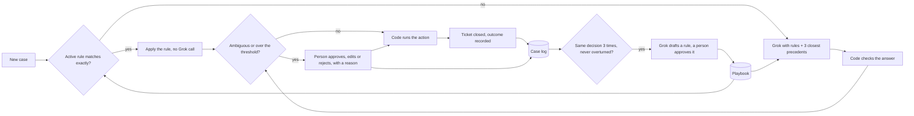

# Grok agent

Design for the **Grok decides** column of the process map, shared by all three rows. Parent index: [DECISIONS.md](DECISIONS.md). Owner: Flavio.

## TL;DR

- **One agent for every lane.** Today each lane calls Grok on its own. Dispute has two copies of `call_grok`, Order has its Grokbot steps, and Shipping has a case package nobody sends. They become one client, one contract and one Playbook.
- **Grok proposes, code checks, a person decides when it is unclear.** Grok never writes an amount or a document. Every number it uses must come from the facts it was given.
- **It learns from every human decision.** Each sign-off is saved with its reason. Similar cases then reuse it as a precedent. When the same decision repeats, it becomes a Playbook rule, after a person approves the rule.
- **The case curve.** Week after week, a smaller share of cases needs a person. The curve flattens at a floor: some cases always need sign-off, such as anything over €500.
- **Efficiency on top of the loop:**
  - cases that match an approved rule exactly skip the Grok call
  - similar open questions go to a person together
  - the confidence threshold is tuned on real agreement data
  - past cases are replayed before any rule goes live

## Where Grok is called

These are the white boxes in the **Grok decides** column of the map, plus the two Grok steps already designed in the lanes.

| Row | Box on the map | Grok gets | Grok proposes | Code checks before anything happens |
|---|---|---|---|---|
| Order | Fix the hard ones: unclear EDI (`parse_flags`) | The EDI segment that failed and the parser's flag | A corrected field, sent back to the parser | The parser must read it cleanly on the second pass |
| Order | Fix the hard ones: stock short (`qty_short`) | The order line, the stock available to promise, the delivery date | A split delivery, a later date, or a negotiation email | Stock covers the split, and the date is in the window |
| Order | Fix the hard ones: price mismatch | The order price, the contract price list, the promo sheet | A draft email to the retailer | No price is changed by Grok |
| Shipping | Explain the flags, and the exception cases | `grok_case_package` (threeway result, shipment, scans, the failed check) | One cause per line with its € share, or a resolution from the allowed actions | `submit_resolution_proposal`: stock, batch, truck, window and approval rules |
| Dispute | Read the claim | The claim email text | Order ref, invoice ref, product, quantity, amount, claim type, confidence | The refs exist in the Mini ERP, or they stay empty |
| Dispute | Verdict + sources | The claim, the facts, the contract excerpt, the Playbook | Accept, partial or reject, with a source for every point | Amounts match the facts and threeway |

The sign-off rules stay as each lane decided them:
- **Order:** a person always signs before ORDRSP (`order-dec.md`).
- **Shipping and Dispute:** a person signs over €500, or when Grok is unsure or has no source.

## One contract for every call

Every lane sends the same kind of request and gets the same kind of answer. The only things that change between lanes are the task name, the facts and the allowed actions.

**Request**, built by code:

```json
{
  "task": "dispute.verdict",
  "case_id": "CASE-00042",
  "facts": [
    {"id": "F1", "kind": "invoice_line", "value": {"qty": 40, "unit_price": 15.5}, "source": "INV-FT-2026-1187"},
    {"id": "F2", "kind": "desadv_line", "value": {"qty": 28}, "source": "DESADV-2026-00481"}
  ],
  "rules": ["R-DSP-007"],
  "precedents": ["CASE-00017", "CASE-00031"],
  "allowed_actions": ["accept", "partial", "reject"],
  "sign_off_over_eur": 500
}
```

**Answer**, from Grok as JSON:

```json
{
  "action": "partial",
  "params": {"amount_eur": 186.0},
  "citations": ["F1", "F2", "R-DSP-007"],
  "confidence": 0.82,
  "open_questions": [],
  "precedents_used": ["CASE-00017"]
}
```

**Code checks every answer.** The answer is rejected when:
- the JSON does not match the schema
- a number is not in the facts
- a citation does not exist
- the action is not allowed

A rejected answer is sent back to Grok once, with the reason. If it fails again, the case goes to a person.

## When it asks a person

A case goes to the sign-off desk when any of these is true:
- the lane's own rule says so (Order: always; others: over €500)
- Grok's confidence is under the threshold for that task (starting at 0.7, then tuned, see below)
- Grok listed an open question
- facts are missing or conflict, for example two invoices match one claim
- there is no rule and no close precedent for this kind of case
- the code rejected Grok's answer twice

The person sees the case, Grok's proposal with its sources, and **the one question that blocks it**. They approve, edit or reject, and **must write one line on why**. That line is what the agent learns from.

## The learning loop



How it works:

1. **Before deciding**, the agent loads:
   - the active Playbook rules for the task
   - the three most similar past cases, matched on task, case type, retailer, product, threeway reason, amount band and which documents exist
2. **Grok decides** and cites the rules and precedents it used.
3. **A person resolves** the unclear cases. The decision and its reason go into the case log.
4. **The ticket closes**, and the outcome is recorded:
   - credit note accepted
   - claim not reopened within 30 days
   - payment received in full

   So the log knows whether the decision held, not only whether a person liked it.
5. **Promotion.** When the same kind of case got the same decision three times and was never overturned, Grok drafts a rule. A person approves it before it goes live; Playbook changes always need a person. From then on that kind of case is decided by the rule.
6. **Demotion.** If a rule's decision is later edited by a person, or its outcome goes bad (the claim is reopened), the rule goes back to draft. Its cases go to a person again until it is fixed.

**The case curve.** Two numbers per week, drawn as a chart:
- **share of cases that needed a person:** falls, then flattens at the floor of cases that always need sign-off
- **share of Grok proposals the person approved without edits:** rises

On Order every case is signed, so there the second number is the one that shows learning.

## Making it more efficient

Beyond the loop itself:

1. **Skip Grok when a rule matches.** An exact match on an active rule is decided by code, with the rule as the citation. It is faster, costs nothing and gives the same answer every time.
2. **Tune the threshold per task from the log.** For each task, set the confidence threshold so that decisions taken without a person agree with people at least 95% of the time. Extraction and verdicts get different thresholds.
3. **Group similar questions.** "These 6 Esselunga short-payment claims under €50 all lack a DDT: accept all?" One answer from a person teaches the agent six cases.
4. **Ask the most useful question first.** The sign-off queue is ordered by how many open cases share the pattern, not by arrival time.
5. **Replay before a rule goes live.** Every new or changed rule is run against all past cases first. If it would flip a decision a person approved, it is flagged instead of activated. The same replay produces the case curve for the demo.
6. **Learn from outcomes, not only from people.** Reopened claims, rejected credit notes and short payments count against the decision that caused them.
7. **One client, used everywhere:**
   - JSON output with a schema
   - one retry that carries the code's error message
   - a model per task (a fast one for reading claims, the strongest for verdicts), set by `XAI_MODEL_<TASK>`
   - the Playbook as a fixed prompt prefix, so repeated calls can be cached

## Where things live

| Thing | Where | Notes |
|---|---|---|
| Grok client | `agent/grok.py` | Replaces the two `call_grok` copies in `dispute/`. Reads `XAI_API_KEY` or `GROK_API_KEY`, plus `XAI_BASE_URL` and `XAI_MODEL`, as they work today |
| Contract and checks | `agent/contract.py` | The request and answer schemas, the number check, the citation check |
| Case log | `agent_cases` table in the Mini ERP SQLite | Case, facts, proposal, confidence, why a person was asked, their decision, their reason, outcome, rules and precedents used |
| Rules | `playbook_rules` table | Pattern, action, status (`draft`, `active`, `retired`), how many cases support it, who approved it, last time overturned |
| Playbook for people and for Grok | `data/playbook/<lane>.md`, generated from the rules table | Same layout as today's `data/disputes/playbook.md`, which moves there with the Dispute owner's OK |
| Replay and case curve | `agent/replay.py` | Runs past cases in order, with a scripted "person", and draws the weekly chart |

## Demo, about 20 seconds

1. **The chart.** Replay 60 invented cases over 6 weeks. The share needing a person drops, for example from about 70% to about 20% (the real numbers come from the replay).
2. **One live case.** An unclear claim goes to the sign-off desk, and the person decides with a reason. The next claim of the same kind is resolved on its own, citing that case as its precedent.

## Build plan, about 10 hours

| # | Step | Done when | Hours |
|---|---|---|---|
| 1 | Shared client and contract, and move `dispute/claim_reader.py` and `dispute/verdict.py` onto it | Dispute tests still pass with one client | 1.5 |
| 2 | Case log and rules tables, and the Playbook generator | A sign-off writes a case, and the Playbook file updates | 1.5 |
| 3 | Rule match and precedent search | An exact match skips Grok; otherwise the 3 closest cases go into the prompt | 1.5 |
| 4 | The ask-a-person gate, with a mandatory reason | Every trigger above sends the case to the desk | 1 |
| 5 | Promotion and demotion | 3 matching decisions give a draft rule; an overturned rule goes back to draft | 1 |
| 6 | Replay and case curve | The chart for 60 cases over 6 weeks | 2 |
| 7 | Wire in the call sites, one call per lane owner: Order (3), Shipping (1), Dispute (2) | Every white box on the map goes through the agent | 2 |

## Open questions

- Which Grok models and keys the hackathon gives us, and the rate limits
- Who builds the sign-off page that all lanes share
- The starting confidence threshold for each task (0.7 until we have data)
