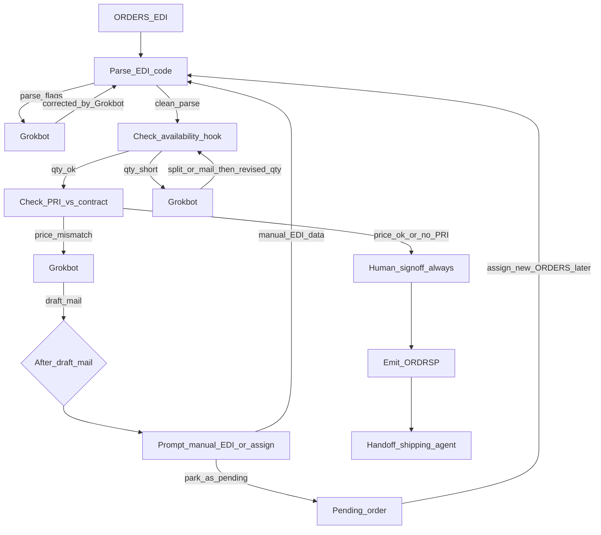

# Order decisions (subdocument of [DECISIONS.md](DECISIONS.md))

Design for the **Order** row of B.R.C x Grok. Parent index of cross-area decisions: [DECISIONS.md](DECISIONS.md). Findings file for the area: [docs/order.md](docs/order.md).

## Scope

Solo la riga **Order**: ORDERS → parse → checks → (Grok se serve) → **sign-off sempre** → ORDRSP → handoff a Shipping/WMS.

Fuori scope: DESADV, FatturaPA, threeway, dispute.

## Regole fissate

- **ORDRSP** è obbligatorio prima dello shipping (sottointeso nel flusso; resta esplicito nel design).
- **Niente soglia €500** per Order: era solo uno sketch della mappa; per noi non guida il routing.
- **Prezzo**: se l’ORDERS dichiara un prezzo (`PRI` o equivalente), si verifica contro il **contratto fittizio** Scotti↔retailer (listino + eventuali sconti per soglia quantità). Se manca il prezzo sull’ordine, non si inventa un mismatch su PRI assente.
- **Quantità**: si confronta con **disponibilità** (non con una “media storica store”). Disponibilità = hook lasciato dal compagno Core/Mini ERP; stub finché non c’è.
- **Sign-off umano prima della cessione a delivery: sempre**, anche se tutti i check passano. Zero-touch qui significa: il sistema prepara tutto; la persona conferma sempre prima di ORDRSP/handoff.

## Cosa significa “usual qty” (e perché la escludiamo)

In [docs/process-map.md](docs/process-map.md) “usual qty” = anomalia rispetto alla **storia tipica di quello store** (es. 3× la media), non = stock. Serve a pescare errori/outlier. **Nel nostro flusso Order non la usiamo**: la quantità si gestisce solo vs disponibilità (+ decisioni Grok su split/negoziazione). Eventuale check storico resta out of scope / altra area.

## Cosa significa `parse_flags`

Segnali che il **parser EDI (codice)** alza quando l’ordine non è “pulito”, *prima* dei check stock/prezzo. Non è un check di business: è “questo file/segmento non l’ho letto in modo sicuro”.

Esempi: segmento obbligatorio mancante; `QTY` ambigua (`20.000` vs `20000`); GTIN malformato; `NAD+BY`/`NAD+SU` assenti o non interpretable; segmenti spezzati / `'` mancanti dopo normalizzazione spazi/indent.

Quei casi → **Grokbot** identifica e propone la correzione → si **rientra in Parse EDI** sul messaggio/ordine corretto da Grokbot (non si salta ai check finché il parse non è netto). Parse netto → niente flag → disponibilità → prezzo → sign-off.

## Pipeline

Grokbot **non chiude** i casi `parse_flags` / `qty_short` andando dritto al sign-off: corregge e **rimanda allo step di codice** che aveva fallito.

### 1. Parse EDI (codice)

- Campi chiave: `BGM`, `DTM`, `NAD+BY`, `NAD+SU`, `LIN`, `QTY` (+ `PRI` se presente).
- Normalizzare whitespace/indent; segment terminator `'`; decimali IT vs plain (`20.000` vs `20000`).
- Segmenti/campi ambigui o incompleti → **flag → Grokbot** (non silenziare).
- Grokbot restituisce la correzione (EDI e/o campi normalizzati) → **di nuovo Parse EDI** su quella versione. Solo parse senza flag procede ai check.

### 2. Disponibilità (hook)

- Interfaccia tipo `getAvailability({ gtin, buyer, supplier, requestedDate })` con implementazione stub/`TODO` finché Core non fornisce stock + production events.
- Qty entro disponibilità → avanti al check prezzo.
- Qty oltre → Grokbot sceglie tra (**split oppure mail**):
  - **split** su più giornate (priorità a chiudere questo ordine prima dei nuovi) + comunicazione informativa all’azienda;
  - **mail** all’azienda: insufficienza di disponibilità, accordo su qty inferiore (eventuale sconto da contratto).
- In entrambi i casi, con le qty riviste si **ritorna al check disponibilità** (non al sign-off diretto). Il loop continua finché `qty_ok` (con un limite di tentativi in implementazione per evitare cicli infiniti).

### 3. Prezzo (codice + contratto fittizio)

- Contratto demo in `data/` (o equivalente): listino, soglie sconto quantità, buyer/supplier.
- Se `PRI` presente: deve combaciare col prezzo contrattuale applicabile alla qty (pieno o scontato se soglia rispettata).
- Mismatch → Grokbot prepara **bozza mail** che cita il contratto; **persona** rivede e invia manualmente (nessun send automatico).
- **Non** si va al `Human_signoff_always` di conferma ordine. Dopo la draft mail c’è uno **split** verso un altro step umano dedicato (sotto).

### 4. Dopo draft mail (price mismatch): prompt manual EDI / assign

Step umano distinto dal sign-off di conferma:

**Prompt user for manual EDI / assign EDI to order**

Lo user sceglie una delle due:

1. **Manual EDI** — inserisce lui i dati necessari (campi corretti / EDI rivisto). Si **rientra in Parse EDI** su quella versione.
2. **Park as pending** — mette da parte l’ordine come **pending**. Più tardi può **associare un nuovo ORDERS** a quel pending; l’EDI nuovo entra di nuovo da **Parse EDI** e ripercorre i check.

Finché non c’è un EDI accettato dal parse + checks ok, questo ramo **non** emette ORDRSP e **non** fa handoff a shipping.

### 5. Sign-off di conferma (sempre, solo sul path “checks ok”)

- Vale per gli ordini che hanno passato parse pulito + disponibilità + prezzo (o no PRI).
- Coda/UI di conferma con: ordine parsato, esiti check, proposta Grok se veniva da qty/split già rientrata nei check, bozza ORDRSP.
- Solo dopo OK umano → emissione ORDRSP e handoff.
- Il path prezzo errato **non** usa questo sign-off; usa lo step §4.

### 6. Out

- **ORDRSP** (codice, da dati confermati) salvato in Mini ERP.
- Payload handoff a shipping: righe confermate, date, riferimenti ordine/ORDRSP (niente ORDERS grezzo non confermato).

## Grokbot (come si fa, a livello design)

- Chiamata API con contesto strutturato: ordine normalizzato, flags/check results, estratto contratto + Playbook.
- Output JSON vincolato (`azione`, `righe`, `messaggio_bozza`, `confidence`, `sources`).
- Grok **non digita importi finali** nei documenti ufficiali: li scrive il codice dai campi confermati (allineato a [DECISIONS.md](DECISIONS.md)).

## Impatto docs (quando si implementerà)

- Aggiornare [docs/order.md](docs/order.md) con owner flow e queste regole.
- Una riga in [DECISIONS.md](DECISIONS.md): per Order, sign-off sempre prima di ORDRSP; niente soglia €500 su questa riga (la mappa restava sketch).

## Non in questo documento (ancora)

- Implementazione codice, wiring API Grok reale, schema Mini ERP definitivo del compagno (solo contratto di interfaccia + stub).
